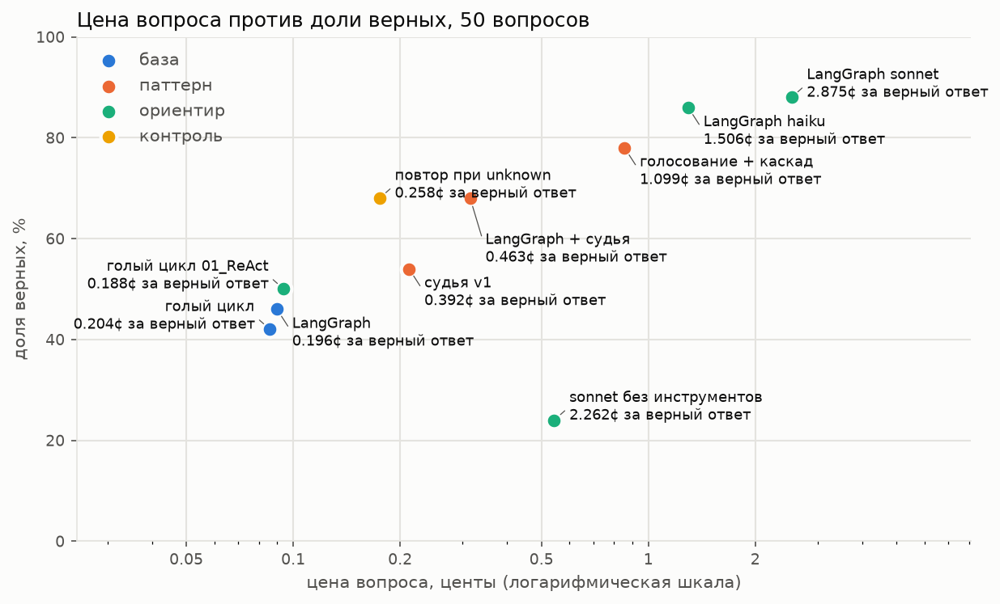

# Домашка 3: фреймворк, судья, голосование — что окупается

Агент-викторина по ЧМ-2026 из первой домашки (01_ReAct) перенесён на LangGraph, поверх него добавлены два паттерна
недели: судья с опорой на инструменты и голосование с каскадом. Набор — первые 50 вопросов
[data/fresh.jsonl](data/fresh.jsonl), дешёвая модель везде gpt-4o-mini. Всё, что нужно из 01_ReAct, скопировано
в этот репозиторий, симлинк не нужен.

## Запуск

```bash
cp .env.example .env                                       # OPENROUTER_API_KEY=...
uv sync
uv run python bare_loop.py --limit 50                     # голый цикл 01_ReAct одним прогоном через счётчик
uv run python langgraph_agent.py --limit 50                # LangGraph без паттернов
uv run python langgraph_agent.py --level mid --limit 50 --tag "LangGraph на haiku-4.5"
uv run python langgraph_agent.py --level strong --limit 50 --tag "LangGraph на sonnet-4.6"
uv run python patterns.py --pattern judge --limit 50       # LangGraph + судья
uv run python patterns.py --pattern retry --limit 50       # контроль к судье: повтор при unknown без судьи
uv run python patterns.py --pattern vote --limit 50        # голосование 3 + каскад на haiku-4.5
uv run python framework_tax.py                             # первый запрос голого цикла и LangGraph: токены и байты
uv run python report.py                                    # таблица, картинка, счёт судьи и каскада; без вызовов модели
uv run pytest tests                                        # тесты проверки ответа
```

| Файл | Что внутри |
| --- | --- |
| [langgraph_agent.py](langgraph_agent.py) | агент на LangGraph, счётчик на `httpx.Client` с крючками, потолок вызовов |
| [bare_loop.py](bare_loop.py) | голый цикл из 01_ReAct (копия) — запросы байт в байт как там, но через тот же счётчик |
| [patterns.py](patterns.py) | графы судьи, повтора при unknown и голосования с каскадом |
| [framework_tax.py](framework_tax.py) | налог фреймворка: первый запрос голого цикла и LangGraph через один счётчик |
| [answer_check.py](answer_check.py) | проверка ответа: копия из 01_ReAct плюс правило 6 из «Проверки проверки» |
| [report.py](report.py) | сборка итога из `results/` и `baseline/`, картинка, «Проверка проверки» |
| [utils/](utils) | копия из 01_ReAct без изменений: инструменты Википедии и исходная `answer_check` |
| [data/fresh.jsonl](data/fresh.jsonl) | копия набора вопросов из 01_ReAct |
| [baseline/](baseline) | копия трейсов и CSV 01_ReAct для первых 50 вопросов: gpt-4o-mini (повторный запуск, иначе исходный) и claude-sonnet-4.6 без инструментов |
| [tests/](tests) | тесты проверки ответа |
| `results/<конфиг>__<уровень>.csv` | строка на вопрос: верно, вызовы, токены, цена, колонки паттерна |
| `results/calls.csv` | каждый вызов модели из счётчика: метка, вопрос, модель, токены, цена |
| `results/report.md` | всё, что печатает `report.py` |
| `results/framework_tax.md`, `results/first_request/` | всё, что печатает `framework_tax.py`, и оба первых запроса как есть |
| `traces/<конфиг>/<модель>/<id>.json` | трейс вопроса; у паттернов — все раунды и голоса |

## Итог

| конфигурация | верно | доля верных | вызовов на вопрос | токенов на вопрос | центов на вопрос | центов за верный |
| :-- | :-- | --: | --: | --: | --: | --: |
| голый цикл, gpt-4o-mini (один прогон через счётчик) | 21/50 | 0.42 | 6.1 | 6515 | 0.086 | 0.204 |
| LangGraph, gpt-4o-mini | 23/50 | 0.46 | 6.1 | 6241 | 0.090 | 0.196 |
| LangGraph + повтор при unknown (контроль к судье) | 34/50 | 0.68 | 11.5 | 13501 | 0.175 | 0.258 |
| LangGraph + судья v1 (принимал unknown) | 27/50 | 0.54 | 13.1 | 15340 | 0.212 | 0.392 |
| **LangGraph + судья** | 34/50 | 0.68 | 19.6 | 23501 | 0.315 | 0.463 |
| **голосование 3 + каскад на haiku-4.5** | 39/50 | 0.78 | 21.3 | 25403 | 0.857 | 1.099 |
| LangGraph на claude-haiku-4.5 | 43/50 | 0.86 | 5.1 | 10876 | 1.295 | 1.506 |
| LangGraph на claude-sonnet-4.6 | 44/50 | 0.88 | 4.3 | 7076 | 2.530 | 2.875 |
| голый цикл 01_ReAct: повтор только провалов | 25/50 | 0.50 | 6.2 | ≈7175 | 0.094 | 0.188 |
| claude-sonnet-4.6 без инструментов (01_ReAct) | 12/50 | 0.24 | 1 | ≈397 | 0.543 | 2.262 |



Откуда строки:

- **Голый цикл** — [bare_loop.py](bare_loop.py): `agent_loop` из 01_ReAct скопирован как есть и прогнан один
  раз по всем 50 вопросам через тот же счётчик, что и LangGraph. Тело запроса собирает тот же `requests`, байты
  совпадают с `results/first_request/bare.json`.
- **Голый цикл 01_ReAct** — строка, которую задание велит собрать из 01_ReAct: повторный запуск, а где его не было,
  исходный прогон. Оставлена для справки, но сравнивать с ней нечестно: повторно запускались только провалы,
  поэтому 15 вопросов из 50 — это ровно удачи исходного прогона, которые не перепроверялись. Отсюда 0.50 против
  0.42 у честного прогона.
- **Тот же агент на haiku и sonnet** — `langgraph_agent.py` с `--level mid` и `--level strong`, без изменений
  в графе. У sonnet в число вызовов попал один ответ 429 (fresh-7, повторён SDK, цена 0).
- **Sonnet без инструментов** взят из 01_ReAct, как требует задание.
- **Верность во всех строках** пересчитана `report.py` по полному FINAL из трейсов одной и той же
  [answer_check.py](answer_check.py) — с правилом 6 из «Проверки проверки». Исходная проверка дала на 0–2 верных
  меньше в каждой строке.
- **≈ токены.** В 01_ReAct токены не сохранялись, поэтому для этих двух строк они оценены tiktoken по трейсам.
  На трейсах LangGraph та же оценка расходится с точным счётчиком на +0.6%.
- **Остальные строки** — счётчик этого репозитория: один `httpx.Client` с крючками на запрос и ответ, через
  него идут все вызовы, а токены и `usage.cost` берутся из ответа OpenRouter.

Каждая строка — один прогон. Между прогонами одной конфигурации на 50 вопросах разница в 2–4 верных — обычное
дело (например, haiku на одних и тех же 23 вопросах дала 19 верных в своём прогоне и 15 в каскаде), поэтому
разницу меньше этого я не считаю результатом.

**Фреймворк:** при честном сравнении он ничего не стоит и ничего не даёт. LangGraph 23/50, голый цикл 21/50,
цена вопроса 0.090¢ против 0.086¢ — в пределах шума одного прогона, а первый запрос у них одинаковый до токена.

**Что дало прирост:** повтор при `unknown`. Он поднимает mini с 0.46 до 0.68, а верный ответ стоит 0.258¢.
Судья даёт ту же долю, 0.68, но почти вдвое дороже (0.463¢): проверяющий агент поверх правила «unknown — не ответ»
на этом наборе не окупается (раздел «Судья»).

**Сильная модель:** тот же агент на haiku верен в 43/50 за 1.295¢ на вопрос, на sonnet — 44/50 за 2.530¢. Haiku
почти не уступает sonnet и стоит вдвое меньше. Каскад (39/50 за 0.857¢) дешевле haiku на 34%; вся его недостача
в 4 верных приходится на вопросы, которые он и так отдаёт haiku (раздел «Голосование и каскад»).

## Судья

Граф: `answer → judge → answer → judge → answer`, не больше двух попыток исправиться. Судья — тот же агент
с отдельным промптом и инструментами `web_search`/`page_find`: он ищет абзац Википедии, подтверждающий или
опровергающий ответ, затем один вызов `with_structured_output(Verdict)` выносит вердикт
`{supported, issue}`. `issue` уходит агенту замечанием. После третьего ответа судья не вызывается: его вердикт
уже ничего бы не изменил.

| | исправил | испортил | отклонений | вопросов с повторной попыткой |
| --- | --: | --: | --: | --: |
| судья | **13** | **1** | 46 | 30 |
| судья v1 | 5 | 1 | 13 | 10 |

«Исправил» — первый ответ неверен, итоговый верен; «испортил» — наоборот. Сравнение идёт в том же прогоне,
поэтому шум между прогонами не примешивается. Испорченные вопросы:

- у судьи — fresh-14: верный ответ `1990` после отклонения стал `1978`;
- у v1 — fresh-39: `44` стал `16 years`.

Первая версия, v1, оставлена в таблице сознательно. Правило «`unknown` — не ответ» было только в промпте
вердикта, и модель нарушала его: приняла `unknown` с первого раза в 15 вопросах из 50. Её логика —
«в найденном ответа нет, значит unknown подтверждён». Именно на этих вопросах повторный поиск полезнее всего.
После того как правило перенесено в код (`is_unknown` в [patterns.py](patterns.py)), первый вердикт почти
совпадает с проверкой:

| | судья отклонил | судья принял |
| :-- | --: | --: |
| первый ответ верен | 3 | 19 |
| первый ответ неверен | 27 | 1 |

### Контроль: повтор при unknown без судьи

Все 13 исправленных судьёй вопросов начинались с `unknown`, а `unknown` отклоняет код, не вердикт модели.
Значит, прирост мог дать сам повтор. Контроль — граф `answer → reject → answer` в [patterns.py](patterns.py):
те же три раунда и то же замечание `'unknown' is not an answer.`, что шлёт судья, но узел `reject` не зовёт
модель. Проверяющего агента и его находок нет, повтор только при `unknown`.

| | верно | исправил | испортил | вопросов с повтором | центов на вопрос | центов за верный |
| :-- | :-- | --: | --: | --: | --: | --: |
| повтор при unknown | 34/50 | 9 | 0 | 20 | 0.175 | 0.258 |
| судья | 34/50 | 13 | 1 | 30 | 0.315 | 0.463 |

Итог одинаковый, 34/50, а повтор стоит 56% цены судьи. Судья исправил больше, 13 против 9, но и стартовал
ниже: первый ответ у него верен в 22 вопросах, у повтора в 25. Это шум первого прогона, а не заслуга судьи.
Из 13 исправленных судьёй вопросов повтор исправил те же 4 (fresh-10, 23, 24, 35). Остальные расходятся
в обе стороны: 9 только у судьи, 5 только у повтора.

**Вывод:** весь прирост судьи дало правило «`unknown` — не ответ» плюс второй поиск. Вердикт и находки
проверяющего на этом наборе не окупают рост цены вопроса с 0.175¢ до 0.315¢. Работы для собственно проверки почти
не было: из 28 неверных первых ответов 26 — `unknown`. Из двух оставшихся судья принял неверный fresh-28
(«дебют Кюрасао» вместо «первое очко»), а fresh-48 (`67` вместо `58`) отклонил, но исправить не помог.

## Голосование и каскад

Три независимых прогона mini при temperature 0.7 идут параллельно: в графе это `Send` на узел `vote`. Ответы
сравниваются как набор слов после нормализации `answer_check` (`16 years` ≠ `16`, но `March 15` = `15 March`).
Согласие — не меньше двух голосов из трёх за ответ, который не `unknown`. Иначе вопрос уходит тому же агенту
на claude-haiku-4.5.

- **Наверх ушло 23 из 50 (46%).** Там, где большинство нашлось, верно 24/27; из ушедших на haiku — 15/23.
- **На haiku пришлось 67% цены конфигурации.**
- Ложное согласие осталось в 3 вопросах. fresh-6 спорный: `round of 32` вместо `knockout stages`.
  В двух модели ошиблись по сути: fresh-14 — `1998` вместо `1990` двумя голосами из трёх, fresh-48 — `67`
  вместо `58` всеми тремя (сегодняшний счёт Мбаппе вместо счёта на момент рекорда).

### Каскад против того же агента на сильной модели

Сравнивать каскад с sonnet без инструментов (12/50) — лёгкая победа: на свежих вопросах она почти ничего не знает.
Честный ориентир — тот же агент LangGraph на сильной модели по всем 50 вопросам:

| | верно | центов на вопрос | центов за верный |
| :-- | :-- | --: | --: |
| голосование 3 + каскад на haiku | 39/50 | 0.857 | 1.099 |
| LangGraph на haiku-4.5 | 43/50 | 1.295 | 1.506 |
| LangGraph на sonnet-4.6 | 44/50 | 2.530 | 2.875 |

- **Каскад против haiku.** Каскад стоит 66% цены haiku, то есть голоса экономят треть. На 27 вопросах, где
  голоса сошлись, большинство mini верно в 24, ровно как и haiku в своём прогоне на тех же вопросах. Значит,
  маршрутизатор не теряет качество там, где оставляет вопрос mini. Вся недостача каскада, 4 верных, приходится
  на 23 вопроса, ушедших наверх: там один и тот же агент на haiku дал 19 верных в своём прогоне и 15 в каскаде.
  Это шум между прогонами haiku, а не цена голосов.
- **Haiku против sonnet.** Тот же агент на sonnet верен в 44/50 против 43/50 у haiku за вдвое большую цену. Для
  этого набора сильнее haiku брать незачем.
- **Против sonnet верный ответ каскада в 2.6 раза дешевле** (1.099¢ против 2.875¢), но каскад теряет 5 верных
  из 50.

## Потолок на деньги

Число вызовов ограничено кодом, не промптом, на двух уровнях:

1. **Внутри агента.** Счётчик шагов в состоянии графа после `max_steps=8` уводит на финальный вызов без
   инструментов, а `recursion_limit` страхует граф сверху.
2. **На весь вопрос.** `MAX_CALLS_PER_QUESTION=40`: `charge()` проверяет счётчик HTTP перед каждым вызовом
   модели. Графы паттернов заканчивают раньше, если следующий узел может не уложиться: судье нужно до
   6 вызовов, новой попытке ответа до 9. В полном прогоне в этот потолок не упёрся ни один вопрос. В
   проверке с `--budget 10` на fresh-0 судья отклонил ответ, но на новую попытку бюджета уже не хватало:
   граф остановился после 8 вызовов, сохранил ответ и поставил `budget_hit=True`.

У LangGraph потолок `max_steps` сработал на 20 вопросах из 50, и 19 из них закончились `unknown`. Пример,
fresh-14: «Scotland defeated Haiti 1-0 in their group stage match. In what year had Scotland previously
won a World Cup match before this victory?» После 8 шагов и обрыва агент ответил `1998`, эталон `1990`.
Он принял год последнего участия за год последней победы — ту же ошибку делала haiku в 01_ReAct.

## Налог фреймворка на пустом запросе

[framework_tax.py](framework_tax.py) отправляет первый вызов голого цикла и первый вызов LangGraph на простом
вопросе («Which country will host the 2026 FIFA World Cup final?») через один и тот же `httpx.Client` со
счётчиком. Тело голого цикла собирает тот же `requests`, что и в 01_ReAct, и уходит как есть. Оба запроса
лежат в `results/first_request/`, полный вывод — в `results/framework_tax.md`.

| | голый цикл | LangGraph |
| --- | --: | --: |
| prompt_tokens из `usage` | **242** | **242** |
| байт в теле запроса | 1464 | 1421 |

Байт в байт запросы не совпадают, но вся разница — в том, что токенов не стоит:

- **Тело.** Как JSON оно отличается одним ключом `"stream": false`, который OpenAI SDK под LangChain
  добавляет всегда. Ещё различаются порядок ключей и пробелы: `requests` пишет `", "` и `": "` — 58 байт.
  Без пробелов тело голого цикла занимает 1406 байт, у LangGraph это 1406 + 15 байт на `"stream":false,`.
- **Системный промпт, вопрос и схемы инструментов совпадают дословно.** Схемы передаются в `bind_tools` готовыми
  OpenAI-словарями из `wiki_tools`, поэтому описания аргументов не теряются, как это было на семинаре.
  Финальный вызов без инструментов тоже собран так же, как `finish()` в 01_ReAct: последний ответ с вызовами
  удаляется, вместо него добавляется записка `FINISH`.
- **Заголовки.** SDK шлёт свой `User-Agent`, `Accept: application/json` и девять `X-Stainless-*`; модель их
  не видит.

**Стоит ли фреймворк этих токенов:** налог на запросе нулевой, но и сам цикл LangGraph за нас ничего не
сделал. Шаги, финальный вызов и защиту от повтора пришлось написать узлами так же, как в голом цикле. Окупается
он только в паттернах: `Send` даёт параллельные голоса, а состояние графа хранит раунды судьи.

## Проверка проверки

Прочитаны глазами все ответы gpt-4o-mini, которые исходная `answer_check` из 01_ReAct сочла неверными, кроме
`unknown`, которые неверны по определению: от 6 до 9 ответов на конфигурацию, 53 всего. Вердикты записаны
в `REVIEW` в [report.py](report.py), полная таблица с ответами — в `results/report.md`. Агента на haiku и sonnet
глазами не читал: правка проверки не изменила у них ни одного вердикта (43 → 43, 44 → 44).

| конфигурация | проверка ошиблась | спорно, оставлено неверным | неверно | верно до → после правки |
| :-- | --: | --: | --: | --: |
| голый цикл (один прогон) | 1 | 2 | 6 | 20 → 21 |
| LangGraph | 1 | 2 | 3 | 22 → 23 |
| повтор при unknown | 2 | 0 | 6 | 32 → 34 |
| судья v1 | 2 | 2 | 4 | 25 → 27 |
| LangGraph + судья | 1 | 1 | 5 | 33 → 34 |
| голосование + каскад | 1 | 5 | 3 | 38 → 39 |
| голый цикл 01_ReAct | 2 | 0 | 4 | 23 → 25 |

**Что поправлено.** Проверка ошибалась на числе, окружённом словами-заполнителями, в двух вопросах:

- fresh-1, во всех семи конфигурациях на mini: `the 1,000th match in FIFA World Cup history` против эталона
  `1,000th World Cup match`;
- fresh-30: `1994 World Cup` и `the 1994 edition` против `1994 FIFA World Cup`.

Правило «число с единицей» распространено на слова FIFA/World Cup/match/edition: если кроме них в эталоне
только число, достаточно этого числа отдельным словом (правило 6 в [answer_check.py](answer_check.py), это
локальная копия, 01_ReAct не тронут). По всем трейсам, включая первые ответы судьи и отдельные голоса, правка
изменила вердикт только на fresh-1 и fresh-30, и только с «неверно» на «верно». Каждый такой ответ верен
по сути. Попутно засчитан ответ sonnet на fresh-30, `ЧМ-1994 (США 1994)`: он тоже верен по сути. Длинные ответы,
которые проверка принимает, прочитаны отдельно, ложных «верно» среди них нет.

Не каждый ответ с подходящими словами верен: `2022 FIFA World Cup` на fresh-30 и `Damián Bobadilla` (автогол
из матча США — Парагвай) на fresh-21 у голого цикла и повтора помечены неверными, а не спорными.

**Что оставлено неверным, хотя спорно** — 12 ответов:

- Одна фамилия вместо имени (fresh-12 `Abunada`, fresh-21 `Burgess`, fresh-44 `Al-Tambakti`). Промпт
  требует имя дословно как в источнике.
- `round of 32` против `knockout stages` (fresh-6) и `the knockout stage` против `round of 32` (fresh-4).
  По сути это одно и то же: в 2026 году round of 32 и есть первый раунд плей-офф. Но эталон назван иначе.

Больше всего спорных у каскада, 5. Если засчитать их все, он поднимется до 44/50.

**Эталон.** Устаревших эталонов, как 43 → 46 на семинаре, не нашлось: в fresh-14, fresh-39 и fresh-48 эталон
совпадает с фразой `evidence` из статьи о группе. Похожая ловушка есть, но на стороне модели. В fresh-48
`67` — это сегодняшний счёт Мбаппе из статьи о нём самом («France 107 (67)»), а вопрос о моменте рекорда: 58.
